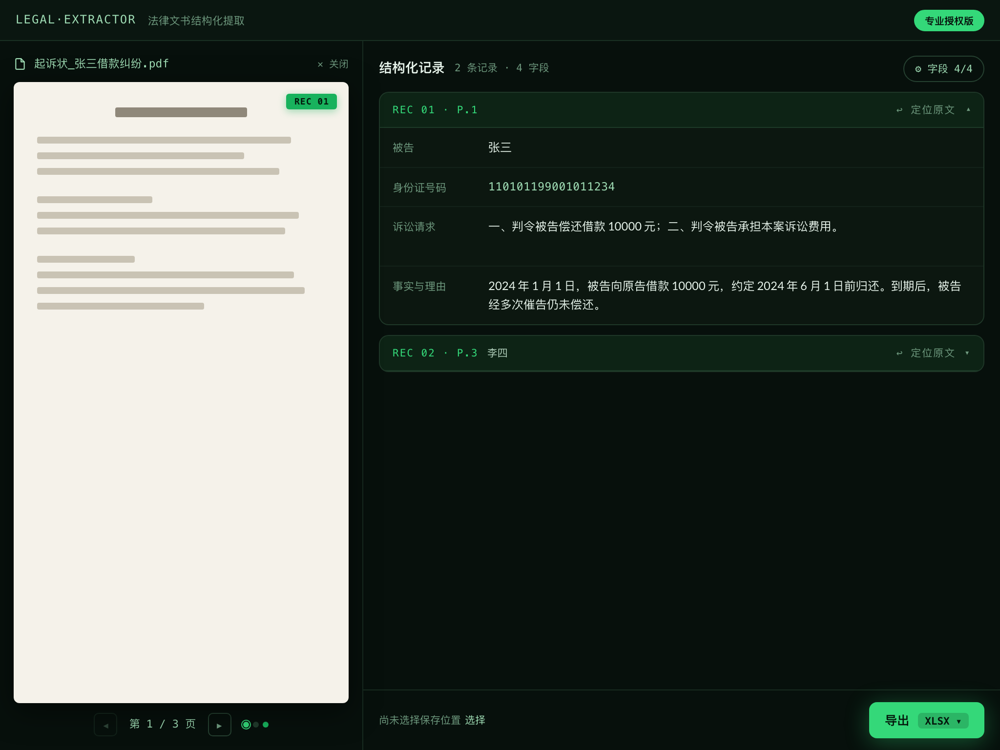

<p align="center">
  
</p>

<h1 align="center">Trawl</h1>

<p align="center">
  <em>Trawl through legal documents — haul structured data out of the paper sea</em>
</p>

<p align="center">
  <a href="README.md">简体中文</a> | English
</p>

<p align="center">
  <a href="https://github.com/can4hou6joeng4/Trawl/releases/latest"></a>
  <a href="https://github.com/can4hou6joeng4/Trawl/actions/workflows/ci.yml"></a>
  <a href="https://github.com/can4hou6joeng4/Trawl/stargazers"></a>
  <a href="https://github.com/can4hou6joeng4/Trawl/graphs/commit-activity"></a>
  <a href="https://github.com/can4hou6joeng4/Trawl/blob/main/LICENSE"></a>
  
  
  
</p>

---

<p align="center">
  
</p>

---

## 🌊 Why "Trawl"

To *trawl through documents* is to comb piles of paper for information — exactly what this app does: it drags a net through Chinese legal complaints and hauls out the defendant, ID number, litigation requests, and facts as clean structured records.

It sails with the nautical family: [Harbor](https://github.com/can4hou6joeng4/Harbor) shelters knowledge, [Beacon](https://github.com/can4hou6joeng4/Beacon) warns before certificates expire, [Atlas](https://github.com/can4hou6joeng4/Atlas) charts every AI coding voyage — and **Trawl** fishes value out of the document sea.

---

## ✨ Features

- 🗂️ **Evidence Desk UI** - Real source pages rendered beside structured records; extracted fields are highlighted in place — on text-layer PDFs, scanned PDFs and photos alike — with two-way locate between page and record.
- 🔑 **Zero-config OCR** - Scanned documents work out of the box through the credential-free relay gateway; no token to apply for.
- 📄 **Smart Parsing** - Auto-detect `.docx`, `.pdf`, and image (`.jpg` / `.png`) legal documents.
- ✏️ **Review-then-Export** - Edit extracted values directly on record cards; manual corrections flow into the export.
- 🎯 **Precise Extraction** - Extract key fields (defendant, ID, requests, facts) with per-field visibility toggles.
- ⚡ **Parallel Processing** - 300% faster text extraction using Go Goroutines.
- 🧩 **Long Documents** - 50+ page PDFs handled in a single cloud job with real per-page progress.
- 💾 **Multi-format Export** - Support Excel (.xlsx), CSV, and JSON.

---

## 🚀 Quick Start

1. Download the installer for your platform from [Releases](https://github.com/can4hou6joeng4/Trawl/releases)
2. **macOS Intel / Apple Silicon**: Download the universal `.dmg`, open it, and drag the app to Applications
3. **Windows x64**: Run the `windows_amd64_setup.exe` installer

Windows ARM64 native builds are tracked as a separate release target because the Windows OCR bridge also needs a verified ARM64 artifact.

📖 **[User Guide / 使用手册 (中文)](docs/user/USER_GUIDE.md)** — full manual for end users and field staff.

### Usage

1. **Drag in or click to select** a legal document — parsing starts automatically and lands on the Evidence Desk
2. Review records on the desk: click any field to correct it, toggle field visibility, or hit **"Locate"** to jump to the source page
3. Pick an export format (XLSX / CSV / JSON) and click **"Export"** — manual corrections are saved with the file

---

## ⚙️ Configuration

**Works out of the box** — scanned PDFs and images are recognized through the official OCR relay gateway; no token or setup required. The app ships with **zero cloud credentials**: requests carry your machine ID, and the gateway meters usage (trial tier daily quota; licensed tier gets more).

**Optional: bring your own AI Studio token** (takes priority over the gateway; also a fallback if the gateway is unreachable). Create `config/conf.yaml`:

```yaml
ocr:
  token: "your_aistudio_token"   # direct connection to the official API
```

Or via environment variable: `LEGAL_EXTRACTOR_OCR_TOKEN`. Legacy `baidu.token` configs keep working.

📖 **[Read the Full Configuration Guide](docs/user/CONFIG_GUIDE.md)**

---

## 🛠️ Development

- Go 1.25+ / Node.js 22+ / [Wails CLI](https://wails.io/docs/gettingstarted/installation)

```bash
git clone https://github.com/can4hou6joeng4/Trawl.git
cd Trawl
cd frontend && npm install && cd ..
wails dev
```

Common commands: `make test`, `make lint`, `make check`; frontend tests via `npm test` in `frontend/`.

---

## 📝 Extraction Fields

| Field         | Rule                                           |
| :------------ | :--------------------------------------------- |
| **Defendant** | Extracted from text after "被告:" (Defendant:) |
| **ID Number** | 18-digit ID number patterns                    |
| **Requests**  | Content between "诉讼请求" and "事实与理由"    |
| **Facts**     | Content between "事实与理由" and "此致"        |

---

## 📄 License

[MIT License](LICENSE) © 2026

---

<p align="center">
  <sub>Made with ❤️ using <a href="https://wails.io">Wails</a> & <a href="https://vuejs.org/">Vue 3</a></sub>
</p>
